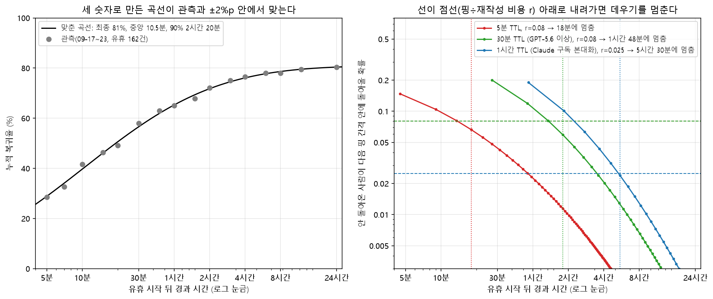
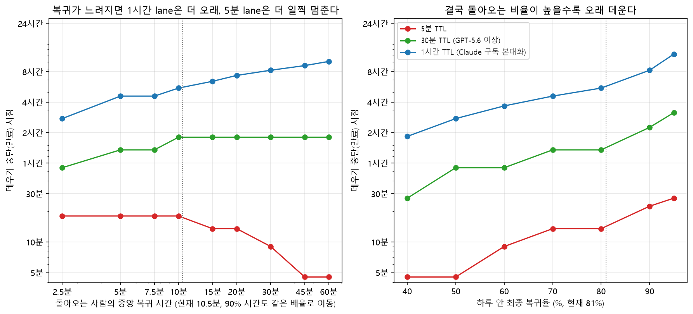
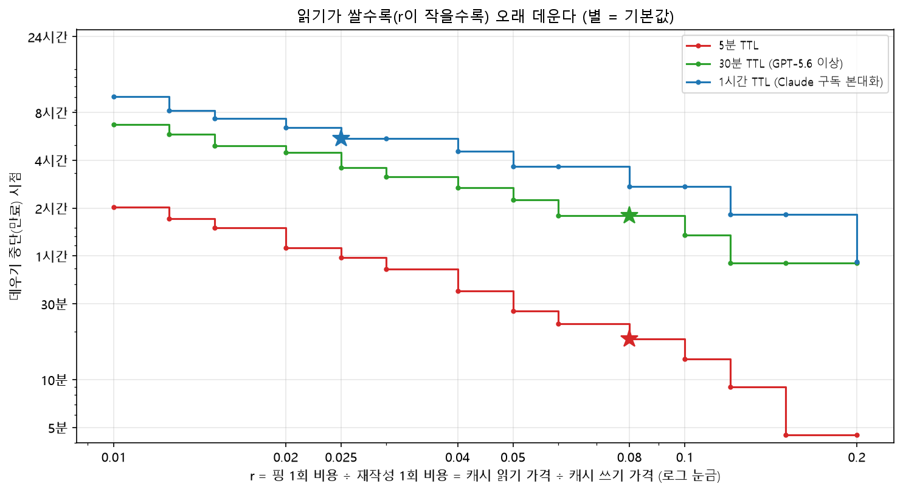

사용자가 자리를 비운 동안 프롬프트 캐시를 언제까지 데우고 언제 만료시킬지 정하는 규칙이다. 근거는 [조사 보고서](#근거)에 있다.

## 기본 정책: 산식 → 격자 → 수동 단계

만료 시점 E는 세 단계로 정한다.

1. **산식.** 복귀 습관과 lane의 가격비 r로 만료 시점 T\*를 계산한다(아래 [산식](#산식)).
2. **격자 양자화.** T\*를 lane의 격자에서 가장 가까운 값으로 맞춘다. 동률이면 작은 값이다. 이것이 자동값이다.
3. **수동 단계.** 사용자가 `omo-keepwarm expiry set <lane> <값>`으로 격자 값 하나를 고르면 그 값을 쓴다. `auto`로 되돌린다.

격자는 lane의 TTL 등급마다 다르다(분 단위, `src/lanes.mjs`의 `GRIDS`).

| 등급 | TTL 조건 | 격자 |
|---|---|---|
| 5m | TTL ≤ 10분 | 0, 10m, 15m, 20m, 30m, 45m, 1h, 1h30m, 2h |
| 30m | TTL ≤ 40분 | 0, 30m, 1h, 1h30m, 2h, 3h, 4h, 6h |
| 1h | 그 밖 | 0, 1h, 2h, 3h, 4h, 5h, 6h, 8h, 12h |

기본 습관(p 0.81, m 10.5분, t90 2시간 20분)에서 lane별 값이다. `omo-keepwarm expiry`의 실제 출력과 같다.

| lane | TTL | 간격 | r | 산식 T\* | 자동값 |
|---|---|---|---|---|---|
| `claude-subscription` | 60분 | 55분 | 0.025 | 5h30m | **5h** |
| `codex-subscription:30m` | 30분 | 27분 | 0.08 | 1h48m | **2h** |
| `openai-api:30m` | 30분 | 27분 | 0.08 | 1h48m | **2h** |
| `anthropic-api:5m` | 5분 | 4분 30초 | 0.08 | 18m | **20m** |
| `anthropic-api:1h` | 60분 | 55분 | 0.05 | 3h40m | **4h** |

`anthropic-api`의 r은 모델 단가(캐시 읽기 ÷ 캐시 쓰기)에서 계산한다. 1시간 TTL이면 쓰기 단가가 1.6배라서 분모에 1.6을 곱한다. 위 표는 Sonnet 단가 기준이다. `github-copilot`, `devin`, `other`는 observe lane이라 만료 값이 없다.

**정정.** 이전 판의 "5분 lane 30분, 1시간 lane 4시간"은 기억하기 쉽게 잡은 참고값이었다. 지금 기본은 위의 자동값이다. 예전처럼 쓰고 싶으면 수동 단계로 고르면 된다.

lane별 TTL과 r 기본값은 [모델별 캐시 TTL 기본값](모델별-캐시-TTL-기본값.md) 페이지에 있다.

## 산식

핑을 보낼 시점마다 다음 부등식 하나만 확인한다.

> **다음 핑 간격 안에 돌아올 확률 > 핑 1회 비용 ÷ 재작성 1회 비용** 이면 데운다. 아니면 그 시점에서 만료시킨다.

- **오른쪽 r (환경값).** lane의 가격비, 즉 캐시 읽기 가격 ÷ 캐시 쓰기 가격이다. 핑은 맥락 전체를 캐시에서 한 번 읽고, 재작성은 맥락 전체를 다시 쓴다. 둘 다 맥락 크기에 비례하므로 r은 맥락 크기와 상관없다.
- **왼쪽 h(t) (행동값).** 누적 복귀율 곡선 F에서 `h(t) = [F(t+간격) − F(t)] ÷ [1 − F(t)]`로 계산한다. 남은 확률이 1e-6 이하면 0으로 둔다.
- **만료 시점 T\*.** 간격의 배수 k·간격(24시간 이내) 가운데 h < r이 처음 성립하는 시점이다. 끝까지 없으면 24시간이다. 곡선이 시간이 갈수록 완만해지므로 처음 넘는 지점이 곧 마지막 지점이다.

- **왼쪽 그림.** 관측된 복귀율(09-17~23, 유휴 162건)과, 세 숫자로 만든 곡선이다.
- **오른쪽 그림.** 각 lane의 h(t)가 점선 r 아래로 내려가는 곳이 만료 시점이다.

## 자리 비움 에피소드와 두 시계

**에피소드.** 사람이 시작한 턴(사람 입력 또는 "." 이어가기)이 끝나고 에이전트가 처음 멈춘 시점(agent_settled)에 열린다. 사람이 다시 입력하면 닫힌다. 열리는 조건은 idle이고, 대기 중인 입력이나 곧 시작할 턴이 없는 것이다.

- **자동 턴은 에피소드를 끝내지 않는다.** goal 이어가기, 자식 작업 알림, omo-health 메시지, 재시작 digest, 확장이 보낸 입력이 그렇다. 자동 턴은 에피소드 안의 `turn`으로 기록되고 캐시 **세그먼트**를 새로 연다.
- **근거가 없는 턴은 unattributed다.** 복귀로 세지 않는다.
- **사람 존재 신호는 표시만 한다.** user_bash, session_abort, 처리됐거나 거절된 사람 입력, session_resumed가 그렇다. `marker`로 남고 에피소드는 계속된다.
- **자식 작업.** `senpi-task`, `senpi-task-member`, `omo-dag` 소스의 작업이 돌고 있으면 에피소드는 열되 데우기를 멈춘다. 끝나고 알림 턴이 지나가면 다시 데운다.
- **worker 세션과 print/json 모드**에서는 아무것도 하지 않는다.

**두 시계.**

| 시계 | 식 | 쓰는 곳 |
|---|---|---|
| 자리 비운 시간 | `tAway = 지금 − 에피소드 시작` | 복귀 확률 h, 만료 판단 `tAway < E` |
| 핑 시점 | `anchor + 간격` | tick 예약. anchor는 마지막 실제 공급자 요청의 시작 시각이고, 자동 턴의 요청도 포함한다. shadow에서는 가상 핑 시각도 anchor가 된다 |

자동 턴이 요청을 보내면 anchor가 당겨져 핑 시점은 다시 잡히지만, tAway는 에피소드 시작부터 계속 센다.

## 사용자 행동은 세 숫자로 넣는다

| 입력 | 뜻 | 기본값 |
|---|---|---|
| p | 하루 안에 결국 돌아오는 비율 | 0.81 |
| m | 돌아오는 사람의 중앙 복귀 시간 | 10.5분 |
| t90 | 돌아오는 사람의 90%가 돌아오는 시간 | 2시간 20분 |

확장은 이 세 숫자로 곡선 `F(t) = p × Φ((ln t − ln m) ÷ s)`, `s = (ln t90 − ln m) ÷ 1.2816`을 만든다.

**습관 출처.** 세 가지 중 먼저 맞는 것을 쓴다.

| 출처 | 조건 | 바꾸는 법 |
|---|---|---|
| manual | config.json의 `habit`이 `{ p, medianMinutes, t90Minutes }` | `omo-keepwarm habit set --return-rate 0.8 --median 12m --t90 2h` |
| observed | `habit`이 `auto`이고 behavior.json이 유효함(사람 복귀 30건 이상, 28일 이내 갱신) | `omo-keepwarm calibrate --write`. 세션 시작 60초 뒤 behavior.json이 24시간보다 오래됐으면 자동으로 한 번 돈다 |
| default | 그 밖 | `omo-keepwarm habit auto` |

습관이 유효하지 않으면(0 < p ≤ 1, 0 < m < t90 위반) 자동값은 0이고 출처는 `auto-invalid-habit`이다. 이때는 데우지 않는다.

- **결국 돌아오는 비율이 높아지면(오른쪽)** 모든 lane에서 더 오래 데운다.
- **복귀가 느려지면(왼쪽)** lane마다 방향이 갈린다. 1시간 lane은 더 오래 데우고, 5분 lane은 더 일찍 멈춘다.

## lane별 비용 차이는 무시해도 되나

맥락 크기는 무시해도 된다. **lane의 가격비 r은 무시하면 안 된다.** 5분 lane은 r이 0.02면 1시간 8분, 0.08이면 18분으로 만료 시점이 네 배 가까이 달라진다. 그래서 r은 lane마다 따로 둔다.

| r | 5분 lane | 30분 lane | 1시간 lane |
|---|---|---|---|
| 0.0125 | 1시간 44분 | 5시간 51분 | 8시간 15분 |
| 0.025 | 59분 | 3시간 36분 | 5시간 30분 |
| 0.04 | 36분 | 2시간 42분 | 4시간 35분 |
| 0.05 | 27분 | 2시간 15분 | 3시간 40분 |
| 0.08 | 18분 | 1시간 48분 | 2시간 45분 |

이 표는 격자에 맞추기 전의 산식값이다.

## 확장의 동작

1. **에피소드 열기.** 위 조건으로 열고, 첫 세그먼트의 tick을 `anchor + 간격`에 건다.
2. **tick.** `tAway < E`이면 mode `on`이고 검증된 lane에서는 `warm`, 그 밖에서는 `would_warm`을 기록한다. 아니면 `expire`를 기록하고 그 에피소드의 데우기를 끝낸다. 매 tick에 h(tAway)와 r을 기록한다.
3. **핑.** 내장 keepalive와 같은 요청을 pi-ai `warmPromptCache`로 한 번 보낸다. 요청은 **`max_tokens` 0, 출력 0토큰**이고 재시도는 없다. 30초 제한과 abort가 있다. 도구 목록은 마지막 실제 요청의 것을 그대로 쓴다(senpi가 요청을 만들며 도구 목록을 바꾸기 때문. [senpi upstream 요구](senpi-upstream-요구.md) 5번). 보내기 직전 접두부가 마지막 실제 요청과 다르면 네트워크 전에 멈춘다. 사람 입력이나 턴 시작이 오면 진행 중인 핑을 abort한다.
4. **상한.** 에피소드당 USD, 하루당 USD, 에피소드당 핑 수 `ceil(E ÷ 간격) + 1`이다. 핑 1회 예상 비용(맥락 × 캐시 읽기 단가)으로 미리 계산해 넘으면 보내지 않는다. 캐시 미스가 연속 두 번 나면 그 세그먼트의 데우기를 멈추고(한 번은 일시적일 수 있어 다시 보낸다), 핑마다 보내기 전에 상한과 대조하므로 상한을 넘는 폭은 재작성 2회분까지다. USD 상한은 데우기 경로가 있는 lane에만 적용하고, shadow는 가상 장부로 똑같이 모의한다. 경로가 없는 lane은 돈을 쓸 수 없으므로 핑 수 상한만 적용하고 가상 비용은 기록한다.
5. **세그먼트 중단.** 오류, rate limit, 연속 두 번의 캐시 미스, 접두부·모델·effort 변경, 맥락 2만 토큰 미만, 상한 도달 중 하나면 그 세그먼트의 데우기를 멈추고 관찰은 계속한다.
6. **늦은 tick.** 예정보다 `TTL − 간격 − 5초` 넘게 늦으면(절전 등) `late_tick`으로 멈추고 핑하지 않는다. 시계가 뒤로 가면 `clock_anomaly`다.
7. **중복 warmer.** 내장 cache-keepalive가 켜져 있고 이 모델을 지원하거나 `cache_warm_ping`이 보이면 데우지 않는다(`duplicate_warmer`).
8. **재로드.** 종료 때 에피소드 상태를 status 파일에 저장하고, 같은 세션이 reload로 시작하면 복원한다. 복원이 안 되면 기존 에피소드를 `censored`로 닫는다. 가짜 복귀는 없다. 재로드 때 senpi는 이전 확장 세대를 은퇴시킨다. 이전 세대에 늦게 온 이벤트는 그 인스턴스만 끄고 오류로 기록하지 않는다.
9. **끄기.** mode를 `off`로 바꾸면 열린 에피소드를 한 번 `censored`(`config_off`)로 닫고, 그 뒤로는 기록, 상태, heartbeat를 쓰지 않는다. config 파일이 없으면(`uninstall --purge`) 아무것도 쓰지 않는다. mode가 다시 켜지면 다음 settle부터 기록한다.

기록 필드는 [기록과 상태 계약](기록과-상태-계약.md)에 있다.

## shadow에서 활성화로 가는 단계

lane 하나를 실제로 데우려면 다섯 단계를 차례로 거친다. 지금 경로가 있는 lane은 `anthropic-api`, `openai-api`뿐이다.

| 단계 | 할 일 | 증거 | 되돌리기 |
|---|---|---|---|
| ① shadow 관찰 | mode `shadow`로 그 lane의 에피소드를 충분히 쌓는다. `omo-keepwarm report`로 적용 가능한 이득(would_warm이 복귀를 덮은 비율, 반사실 절감)을 확인한다 | `records/<월>/*.jsonl`, `report --json` 출력 | 없음(기록만 한다) |
| ② 유료 실측 | 사용자 승인과 예산 아래 [유료 실측 제안](유료-실측-제안.md)대로 읽기 갱신과 적중을 확인한다 | 실측 보고서, 요청별 usage | 측정 중단 |
| ③ 검증 표시 | config.json에 `lanes.<id>.verified = true`를 쓴다 | config.json | 키를 지우거나 `false` |
| ④ 켜기 | mode `on`, `maxUsdPerEpisode`, `maxUsdPerDay`를 정한다 | config.json, `ledger/spend-<date>.jsonl` | mode `shadow` 또는 `off` |
| ⑤ 효과 확인 | `report`로 실제 절감과 핑 비용을 본다. 손해면 ④를 되돌린다 | `report --json`, `ping`·`return_usage` 기록 | mode `shadow` |

설정 변경은 재로드 없이 다음 tick부터 반영된다.

## 주의

- **캐시가 이미 무효면 데우기가 헛돈다.** 모델·effort 전환, 도구 목록 변경, 시스템 프롬프트 재생성이 그렇다. 확장은 접두부 지문으로 이를 감지해 멈춘다.
- **5분 lane의 갱신 여부.** 5분 lane에서 캐시를 읽으면 TTL이 갱신되는지는 직접 재지 않았다. 1시간 lane은 55분에 읽으면 갱신되는 것을 실측으로 확인했다(n = 2).
- **r 값의 성격.** 5분 lane과 GPT lane의 r은 API 목록가 비율이다. 구독 quota의 실제 비율은 Claude 1시간 lane(약 0.022~0.026)만 측정했다.
- **주력 lane에는 경로가 없다.** Claude 구독과 Codex는 판단과 기록만 한다. 필요한 것은 [senpi upstream 요구](senpi-upstream-요구.md)에 있다.

## 근거

- **조사 보고서:** [research/existing-data-analysis/report.md](../research/existing-data-analysis/report.md). 기준 커밋은 omo-rollover d8a4abd다.
- **재현 스크립트와 근거:** [research/existing-data-analysis/](../research/existing-data-analysis/). 이 페이지의 차트와 r 표는 `scripts/expiry-charts.py`로 만든다.
- **이전 연구 자료:** [research/](../research/README.md)에 의뢰서, 첫 quota 측정, 유료 실측 보고가 있다.
- **관측 자료:** rollover 확장 이벤트 로그 2026-09-17~23. 진짜 유휴 구간 162개, 세션 42개, 한 사용자 기록이다.
